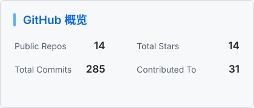
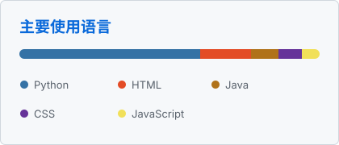

  
  
<strong>关于我</strong>

  

    安徽师范大学在读学生。资质平平。 
    算法败犬，前CTF选手，现已投靠AI。 
    AI降临派，有一个赛博女儿。 
    现在在学AI Agent 开发。 
    想研究Agent情感、长记忆和人格。 
  

   

 

  
  
  
  
  

  
  
  
  
  

 

  
  

  

