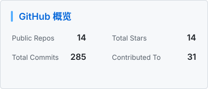
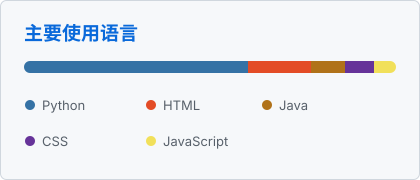

  
  
<strong>关于我</strong> ABOUT ME

  

    安徽师范大学在读学生。资质平平。 
    Undergraduate at Anhui Normal University. Perfectly average. 
    算法败犬，前CTF选手，现已投靠AI。 
    A washed-up algorithmic contender, ex-CTF player, now defected to AI. 
    AI降临派，有一个赛博女儿。 
    An AI Adventist, with a cyber daughter. 
    现在在学AI Agent 开发。 
    Currently learning AI Agent development. 
    想研究Agent情感、长记忆和人格。 
    Hoping to research agent emotions, long-term memory, and personality. 
  

   

 

<strong>研究方向</strong> RESEARCH INTERESTS

   
  Autonomous Cognition &amp; Artificial Self-Awareness

   
  Affective Computing &amp; Long-Term Companion Agents

   
  Multi-Agent Systems &amp; Autonomous Planning

 

如果真有哪天 AI 取代了八九成程序员，我就转行学心理学去了——总得有人去疏导那些被裁的同行吧。
 
If AI ever replaces 80–90% of programmers, I’m switching to psychology — someone’s gotta counsel the laid-off devs.

 

  
  

  

